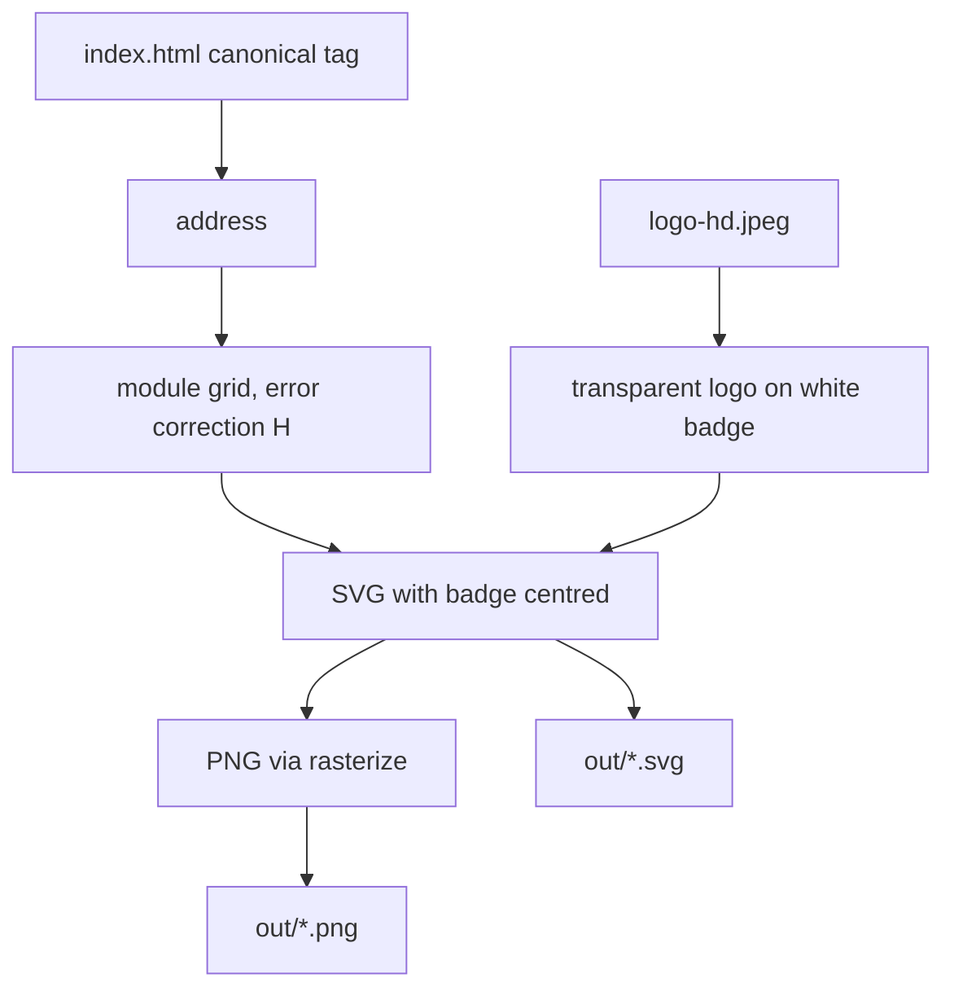

# Static QR Code Generator - Plan

## Goal Capsule

- **Objective:** Someone can scan a printed or shared QR code with a phone and land directly on the Cinq de Coeur website, with the brand's hand-and-spiral logo in the middle of the code.
- **Means:** A local TypeScript script that renders the QR code and logo to image files (KTD1, KTD2).
- **Authority:** Product Contract first, then Planning Contract, then unit details.
- **Stop conditions:** Stop and ask if the code cannot be made to scan reliably with the logo in place, or if the site's canonical address changes domain.
- **Execution profile:** Local developer tooling; no deployed surface.

---

## Product Contract

### Summary

Add a small local script that encodes the site's public address and writes a QR code image with the logo at its centre. The encoded content is the plain address and nothing else, so scanning opens the site with no redirect service or tracking link in between.

### Problem Frame

The business needs a QR code for print and sharing that opens the website on a phone. Online generators usually wrap the address in their own redirect link, which can expire or be switched off, so the printed code stops working. Generating the code locally keeps it permanent and branded.

### Requirements

- R1. The code encodes exactly the site's canonical public address, as plain text, with no redirect, short link, or tracking parameters.
- R2. The brand logo appears at the centre of the code, with no checkerboard or boxed background around it.
- R3. A phone camera scans the finished code and opens the site.
- R4. One command produces a PNG for sharing and an SVG for print.
- R5. The generated files and the full-size logo source stay out of the deployed site.

### Success Criteria

- A generated PNG decodes, with an off-the-shelf decoder, to exactly the canonical address.
- The owner scans the printed or on-screen code with a real phone and reaches the site.

### Scope Boundaries

- No web page, API endpoint, or admin screen for generating codes.
- No analytics, short links, or per-campaign variants.
- Not built: an address override flag or multiple output sizes. The request names one site and one address; add them if a second use appears.

#### Deferred to Follow-Up Work

- A vector or properly transparent logo file would give a sharper print result than the cleaned-up JPEG; swap it in later without changing the script's shape.

### Key Decisions

- **Move the full-size logo out of the Angular public folder.** (session-settled: user-directed — chosen over leaving it in `apps/fiveOfHeart/public/assets/`: a 1.5 MB file there would ship with every site deploy.) Governs R5.

---

## Planning Contract

### Key Technical Decisions

- KTD1. **Native Node type stripping, no TypeScript runner.** `.nvmrc` pins Node 24, which runs `.mts` files directly, so no `tsx` or compile step is added. The root has no `"type"` field and its base tsconfig targets ES modules, which rules out `ts-node` 10.9; the `.mts` extension makes the scripts ESM without touching the root.
- KTD2. **One renderer, two outputs.** The script builds the QR module grid with the `qrcode` package, draws it itself as an SVG with the logo embedded, and rasterizes that same SVG to PNG with `sharp`. Both files therefore always match, and the logo position is computed once.
- KTD3. **Highest error correction, small centre badge.** Level H tolerates roughly 30% damage. The logo sits on a round white badge no wider than about a quarter of the code, and the final size is set by the scan test rather than by eye.
- KTD4. **Logo background removed by colour, at run time.** `logo_hd.jpeg` has a checkerboard baked into its pixels, not real transparency. The logo is a flat brown on a light grey-and-white pattern, so thresholding on distance from the brown gives a clean mask; the result is held in memory, not committed. A hand-supplied transparent file would replace this step (see Deferred).
- KTD5. **Address read from the site's canonical tag.** The script reads the `rel="canonical"` link in `apps/fiveOfHeart/src/index.html`, so the QR cannot drift from the address the site declares. It fails loudly when the tag is missing.
- KTD6. **Dark brown modules, not pure black.** Modules use a dark shade of the brand brown (`theme_color` in `apps/fiveOfHeart/public/site.webmanifest` is `#8d6d51`) on white. The lighter brand brown alone is too low-contrast for reliable scanning, so a darker shade is used and the decode test is the arbiter.
- KTD7. **Tests with `node:test`, outside the Nx projects.** The root Jest config only collects projects that declare Jest, and the script is not an Nx project, so the built-in runner keeps it dependency-free. A decoder package (`jsqr`) is the only test-only addition.

### Output Structure

```text
tools/qr-code/
  assets/logo-hd.jpeg        (moved from apps/fiveOfHeart/public/assets/logo_hd.jpeg)
  generate.mts               (command entry point)
  logo.mts                   (background removal and badge)
  qr.mts                     (module grid to SVG and PNG)
  *.test.mts
  tsconfig.json
  out/                       (generated, git-ignored)
```

The per-unit file lists below are authoritative.

### Risks & Dependencies

- `sharp` downloads a prebuilt native binary on install. It is a dev dependency only, so the production API image (`npm ci --omit=dev` in `Dockerfile`) is unaffected; the frontend build image and CI run a full `npm ci` and pick it up.
- Colour thresholding can leave a faint fringe on the logo's anti-aliased edge. The white badge hides most of it; check the result visually at print size.

---

## Implementation Units

### U1. Scaffold the tool and move the logo

**Goal:** Create the tool folder, relocate the HD logo out of the public assets, and add the dependencies and the npm command.

**Requirements:** R4, R5. Implements the logo-relocation Key Decision.

**Dependencies:** None.

**Files:**

- `tools/qr-code/assets/logo-hd.jpeg` (moved from `apps/fiveOfHeart/public/assets/logo_hd.jpeg`)
- `tools/qr-code/tsconfig.json`
- `package.json` (dev dependencies, `qr:generate` and `qr:test` scripts, `lint:ts` extended to cover the tool)
- `.gitignore` (the `tools/qr-code/out/` folder)

**Approach:**

- Move the file rather than copy it, so the public folder no longer holds it; it is currently untracked, so no git history is lost.
- Add `qrcode`, its types, `sharp`, and `jsqr` as dev dependencies at current versions.
- The tool's tsconfig must allow `.mts` imports and erasable-syntax-only TypeScript, to match KTD1, and be type-checked by the existing `lint:ts` script.

**Test expectation:** none -- scaffolding and configuration; covered by U2 and U3 running through the new scripts.

**Verification:** The public assets folder no longer contains the HD logo, `npm run lint:ts` still passes, and `git status` shows no generated output.

### U2. Prepare the logo

**Goal:** Turn the checkerboard JPEG into a transparent logo on a round white badge, ready to place at the code's centre.

**Requirements:** R2. Follows KTD3, KTD4.

**Dependencies:** U1.

**Files:**

- `tools/qr-code/logo.mts`
- `tools/qr-code/logo.test.mts`

**Approach:**

- Mask every pixel that is not close to the logo's brown, soften the mask edge slightly, and output a transparent image.
- Composite onto a white circle with a margin, sized relative to the code width as set in KTD3.

**Execution note:** Check the result visually on the real file before writing the assertions; the threshold is found by looking, not by guessing.

**Patterns to follow:** None in the repo; this is the first image-processing code.

**Test scenarios:**

- The cleaned logo's corner pixels are fully transparent.
- A pixel inside the palm of the hand is opaque and close to the logo's brown.
- No fully opaque pixel remains with the light-grey checker colour.
- The badge output is square and its centre is white-backed where the logo has gaps (between the fingers).

**Verification:** Viewing the cleaned logo on a dark background shows no checker residue and no clipped fingertips.

### U3. Generate the QR code and verify it decodes

**Goal:** Produce the SVG and PNG with the badge centred, from the site's canonical address, and prove they scan.

**Requirements:** R1, R3, R4. Follows KTD1, KTD2, KTD5, KTD6, KTD7.

**Dependencies:** U2.

**Files:**

- `tools/qr-code/generate.mts`
- `tools/qr-code/qr.mts`
- `tools/qr-code/qr.test.mts`
- `tools/qr-code/generate.test.mts`

**Approach:**

- The entry point reads the canonical address (KTD5), builds the module grid at the highest error correction, and writes both files to the output folder.
- Rendering draws modules, then the badge, into one SVG; the PNG is that SVG rasterized at a size large enough for print.
- Console output names the two files written and the address encoded, so the owner can see what the code points to.

**Technical design:** Directional only.



**Test scenarios:**

- Decoding the generated PNG with `jsqr` returns exactly `https://cinqdecoeur.fr/`, with no query string or fragment.
- The SVG contains the badge image and its size stays within the quarter-of-width limit from KTD3.
- Extracting the canonical address from a sample HTML string returns the `href` value.
- Extracting from HTML with no canonical tag raises an error that names the file.
- The command run writes both a `.png` and a `.svg` into the output folder and reports their paths.

**Verification:** The decode test passes on the real logo, and the owner's phone opens the site from the on-screen PNG and from a printed SVG.

---

## Verification Contract

| Check           | Applies to        | How                                                       |
| --------------- | ----------------- | --------------------------------------------------------- |
| Tool tests      | U2, U3            | `npm run qr:test`                                         |
| Type check      | U1–U3             | `npm run lint:ts`                                         |
| Formatting      | All changed files | `npm run lint:prettier`                                   |
| Real-phone scan | U3                | Scan the on-screen PNG and a printed copy; the site opens |

## Definition of Done

- All units' verification outcomes hold and every command in the Verification Contract passes.
- The HD logo exists only under `tools/qr-code/assets/`, and no generated image is tracked by git.
- A real phone scan of the final output opens `https://cinqdecoeur.fr/`.
- No experimental threshold code, debug images, or abandoned approaches remain in the diff.
